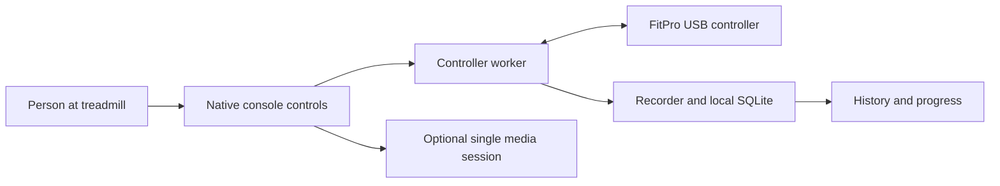

# Architecture and controller behavior

The Android Activity renders native views and hosts one optional, lazy GeckoView browser. A foreground service owns the USB worker, recording and optional heart-rate connection. Browser pages have no treadmill-control API.

The physical emergency Stop and safety key remain essential. UI responsiveness is not a presence sensor. App code and fake tests cannot certify emergency-stop wiring.

## Protocol assumptions

Selected FitPro V1 hardware uses vendor0x213c/product0x0002, interface0 and64-byte USB transfers. Source validates replies/checksums/lengths, controller metadata, supported commands and normal session verification. Read modes are1Idle,2Running,3Pause and8key-out on the reference family. Inspect metadata on any other unit; do not assume matching screen size means matching hardware.

Field0 is the reported/commanded speed in hundredths km/h. It is not an independent physical speed measurement. The separate actual-speed reading was not usable on the reference family. Field17 reports incline; field1 sets incline in hundredths of a percent. Fan field98 is0–4. Optional pulse field10 is a four-byte packet with current BPM in byte0; a zero reply does not verify hand contact or hardware failure.

The source bounds speed to the reference0.5–12mph range and incline to-3..15%. Values and protocol semantics must be checked for the actual device before physical use.

## Motion request rules

A local two-second hold initiates a fresh Start at about1mph. Pause/Stop uses the verified Pause mode rather than writing zero speed, which the reference board rejects. Stop takes priority over queued adjustments. Mode, freshness, authentication, foreground status and UI heartbeat are rechecked around blocking replies.

Only the explicit on-screen finish/Stop requests returning incline to0 after confirmed stopped/key-in readings. Pause, key removal, backgrounding, watchdog recovery and reconnect do not queue deck movement. Requests expire or cancel instead of replaying after reauthentication.

Startup never adopts an old Running state as a resumed workout. It reconciles uncertain/Running state with Pause before enabling local control. An unresponsive UI during possible motion requests Pause from the worker. No automatic Start, speed or incline restoration follows reconnect, app restart or power failure.

## Records and profiles

Profiles use fixed generic slot IDs, with editable display names kept in local preferences. Renaming never rekeys or combines records. Schema4 stores immutable per-workout eligible weight/model and estimated active calories. A single storage executor writes atomic summary/sample batches at about five-second intervals, plus finish/background flushes. WAL recovery closes an interrupted record at its saved timestamp without adding outage time or restoring movement. Power-loss recovery is best effort, not a guarantee of the last few seconds.

## Idle, media and sensors

Confirmed stopped/no-touch five minutes can save/park once, release browser and BLE work and show a dim native clock. First wake gesture is fully consumed, including its Up event; a deliberate second gesture is needed for controls. Motion or uncertain state prevents inactivity parking.

The native Sources button stays outside the browser toolbar that fullscreen pages hide. Media processes remain independent of controller timing. Website playback/DRM can fail; no ad filtering, injected page-control bridge or DRM modification is provided.

Optional heart-rate behavior is source-aware but not proven for every handle/strap. Bluetooth speaker pairing is separate hardware. Never substitute imagined track metadata or receiver controls for an API that has not been verified.
